# Overview

[← Home](../README.md)

## The cluster in one minute

- **Where do I log in?** Shared cluster: `hpc01.isr.tecnico.ulisboa.pt`. Your group's own machine: `hpc-<group>.isr.tecnico.ulisboa.pt` (for example `hpc-dsor`).
- **Where do I run heavy work, and anything that needs a GPU?** Not on the machine you log in to. You ask the scheduler, **SLURM**, for a slice of a machine with `sbatch` (a script that runs by itself) or `salloc` (an interactive shell), and SLURM starts it where there is room.
- **Where do I keep my files?** Source code, notes and results that matter: your **home** (`/home/<username>`), which is the same on every shared node. Python environments, caches and the data a job is reading right now: **`/scratch`**, the node's fast local disk. Neither is backed up.
- **Who do I ask?** Your group's admin: see [Who's who](contacts.md).

```mermaid
%%{init: {"theme": "base", "flowchart": {"curve": "basis", "nodeSpacing": 40, "rankSpacing": 50, "padding": 12}, "themeVariables": {"fontFamily": "Inter, Segoe UI, Helvetica Neue, Arial, sans-serif", "fontSize": "15px", "primaryColor": "#ffffff", "primaryBorderColor": "#94a3b8", "primaryTextColor": "#1e293b", "lineColor": "#64748b", "clusterBkg": "#f8fafc", "clusterBorder": "#cbd5e1", "edgeLabelBackground": "#ffffff"}}}%%
flowchart LR
    ME(["<b>You</b><br/>any computer on the internet"])
    LOGIN["<b>1. Log in</b><br/>ssh to <code>hpc01</code> or <code>hpc-#lt;group#gt;</code><br/>edit, copy files, submit jobs"]
    SLURM["<b>2. Ask SLURM</b><br/>sbatch / salloc<br/>say what you need: GPU, cores, time"]
    RUN["<b>3. Your job runs</b><br/>on a node with a free GPU,<br/>using /scratch for fast files"]
    RES[("<b>4. Keep results</b><br/>in /home or your<br/>group's storage")]
    ME --> LOGIN --> SLURM --> RUN --> RES
    classDef you fill:#f1f5f9,stroke:#64748b,stroke-width:1.5px,color:#1e293b
    classDef shared fill:#e0ecfb,stroke:#2f6fbf,stroke-width:1.5px,color:#0f2a4d
    classDef group fill:#e3f4e8,stroke:#2e8b57,stroke-width:1.5px,color:#123d25
    classDef store fill:#fff1d6,stroke:#c47f12,stroke-width:1.5px,color:#4a2f05
    classDef fast fill:#efe6fa,stroke:#7b4fb3,stroke-width:1.5px,color:#2e1650
    class ME you
    class LOGIN,SLURM shared
    class RUN fast
    class RES store
```

## Pages

1. [Cluster at a glance](cluster.md): which machines exist and what each one is for.
2. [Network](network.md): how to reach the machines, and how they are connected.
3. [Inside a node](node-anatomy.md): what a node has (GPU, local disk, shared storage) and where to put your files.
4. [Who's who](contacts.md): the admin contact for each research group.

After these, continue with the [User Guide](../user-guide/README.md), starting with [Getting an account](../user-guide/01-getting-an-account.md).
