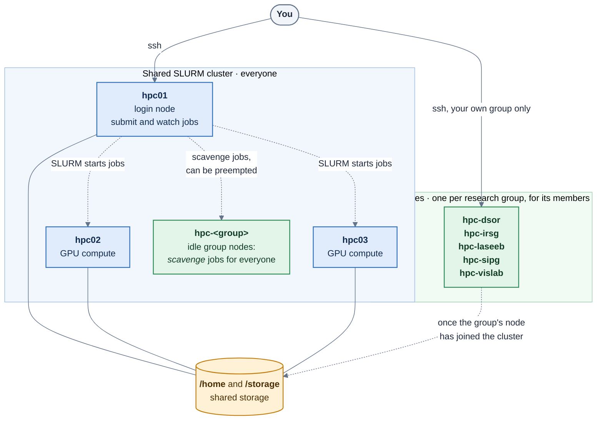

# Cluster at a glance

[← Overview](README.md) · [Home](../README.md)

The ISR HPC cluster is a set of GPU machines (called **nodes**) that you use remotely over SSH. There are two kinds of node, and the difference matters for how you work.

## The machines

| Node | What it is for | Who can use it |
|---|---|---|
| `hpc01` | **Login node** for the shared cluster, and where SLURM is controlled. Edit files, use `git`, submit and watch jobs. Light work only. | Everyone |
| `hpc02`, `hpc03` | **Shared compute nodes**. Jobs with GPUs run here (the `shared` partition). | Everyone, through SLURM jobs |
| `hpc-<group>` | **Your research group's own node**, for example `hpc-dsor`. | Members of that group |

Each node has its own GPU. Your jobs get a whole GPU or a slice of one, depending on what you ask for.

## Which one should I use?

| I want to… | Use |
|---|---|
| Log in, edit code, copy files, submit jobs | `hpc01` |
| Run something that needs a GPU, or a lot of CPU or memory | A **SLURM job** (`sbatch` or `salloc`). It runs on a compute node: you don't choose the node, SLURM does |
| Work on my group's machine | `hpc-<group>`. Group nodes are joining the SLURM cluster one at a time: once yours has, the GPU there is also used through SLURM jobs |

The GPU is **not available in a plain SSH session**, on any node: `nvidia-smi` will fail until you are inside a job. See [SLURM basics](../user-guide/04-slurm-basics.md).

## Things worth knowing

- **Your account.** One account works everywhere, but your group's admin must enable each service for you. A new account can take a while to show up on every node: ask your admin if something is missing. See [Getting an account](../user-guide/01-getting-an-account.md).
- **Shared and group nodes are separate.** Having access to one does not give you access to the other.
- **What is free right now.** `sinfo` on `hpc01`, or [Slurm-web](https://slurm.hpc.isr.tecnico.ulisboa.pt) in a browser, shows which nodes and GPUs are busy.
- **Software.** You can't install system packages on the nodes. Use Python environments on `/scratch`, or containers: see [Storage](../user-guide/03-storage.md#software-environments) and [Apptainer](../user-guide/09-apptainer.md).

Next: [Network](network.md)
