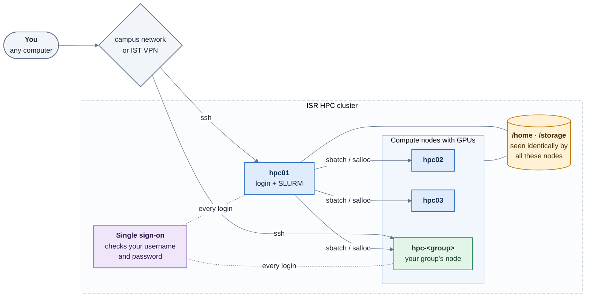

# Network

[← Overview](README.md) · [Home](../README.md)

This page shows how to reach the machines and how a request travels from your laptop to a job. It is the user's view: internal addresses and services are kept in the restricted administrator documentation.

## How to connect

| You want to… | Connect to | From where |
|---|---|---|
| Use the shared cluster | `ssh <username>@hpc01.isr.tecnico.ulisboa.pt` | Anywhere on the internet |
| Use your group's node | `ssh <username>@hpc-<group>.isr.tecnico.ulisboa.pt` | Ask your group's admin for the exact name |

`<username>` is the one you chose when you accepted your invitation. Details, SSH keys and a shortcut for `~/.ssh/config` are in [SSH login](../user-guide/02-ssh-login.md).

You only ever log in to `hpc01` or your group's node. You do **not** log in to `hpc02` and `hpc03` yourself: SLURM starts your job there (you can only open an SSH session on them while you have a job running on that node).

## How a job reaches a GPU

Reading the diagram:

- **Logins.** Your username and password are checked by the central single sign-on (the same account you created with your invitation). It is also what you use for web tools such as [Slurm-web](https://slurm.hpc.isr.tecnico.ulisboa.pt).
- **Jobs.** From `hpc01` you hand a job to SLURM, and SLURM starts it on a compute node with free resources. Your files in `/home` are already there, because the storage is shared between the nodes.
- **Group nodes.** They have their own login, administered by your group. Once a group node has joined the cluster, it uses the same `/home` and SLURM as the shared nodes. See [Group nodes](../user-guide/06-group-nodes.md).

## When something does not connect

1. Check the hostname and your username (see [Getting an account](../user-guide/01-getting-an-account.md)).
2. After several failed attempts you may be blocked for a while. Wait, then try again, instead of retrying repeatedly.
3. Still stuck? Ask your group's admin: see [Who's who](contacts.md).

Next: [Inside a node](node-anatomy.md)
