# Network

[← Overview](README.md) · [Home](../README.md)

Diagram source: [diagrams/network.mmd](diagrams/network.mmd) (Mermaid). After editing it, re-render the SVG as described in [Diagrams](diagrams/README.md).

## What the diagram shows

**One private subnet, two name spaces.** All VMs sit on the IST VPS platform's private subnet `100.68.8.64/27` (interface `ens3`), with names `<name>.isr-hpc.tp.vps.tecnico.ulisboa.pt`. Public names `<name>.isr.tecnico.ulisboa.pt` resolve to **floating IPv4 addresses** that the platform NATs onto the private address (e.g. `hpc01` → `192.92.147.70`); the public IPv4 is not configured on the VM itself. Each VM also has a **global IPv6 address** directly on `ens3` (`2001:690:2139:203a::/64`).

**Inbound traffic.**
- SSH (22) goes straight to each node, protected by firewalld and fail2ban. On the shared cluster users log in only to `hpc01` and reach `hpc02`/`hpc03` through SLURM; on group nodes, only the group's own users. Nodes without a public name are reached from IST's network or [IST's VPN](https://si.tecnico.ulisboa.pt/en/servicos/redes-e-conetividade/vpn/).
- Web traffic (80/443) enters through **Traefik** on `hpc01`, which terminates TLS (Let's Encrypt) and routes by hostname to Docker apps: Authentik (`sso.isr.tecnico.ulisboa.pt`) and the Traefik dashboard (`traefik.hpc.isr.tecnico.ulisboa.pt`, behind Authentik). JupyterHub also runs there but is only a reference configuration, not a service for users.

**Identity.** Every node runs SSSD, which looks up users and checks passwords against Authentik's LDAP outpost (container `ak-outpost-ldap-outpost` on `hpc01`) over LDAPS (636) at `sso.isr.tecnico.ulisboa.pt`.

**Shared cluster traffic.** `hpc01`–`hpc03` accept everything from each other (firewalld rich rules for the three IPs). That covers MooseFS (9419–9422), SLURM (6817–6818) and `srun` I/O (60001–60100).

**Group nodes are independent.** They are not part of MooseFS or SLURM; each keeps its own `/home` and services, chosen by the group. They share only the identity setup (SSSD against Authentik on `hpc01`) and the security baseline. See [Group nodes](../admin-guide/config/group-nodes.md).

**`hpc01` is the critical node.** It hosts the SLURM controller, the MooseFS master and the SSO/LDAP service. If it goes down, new logins (other than cached ones), new jobs and the shared filesystem are all affected. See [MooseFS operations → recovery](../admin-guide/procedures/moosefs-operations.md#recovering-from-loss-of-hpc01-master).

Only `hpc-dsor` and `hpc-irsg` have public names. `hpc-laseeb`, `hpc-sipg` and `hpc-vislab` are reachable only on the private network.

> **TODO:** Storage and services of the IRSg, LaSEEB, SIPg and VisLab group nodes.

Port list: [Ports reference](../admin-guide/reference/ports.md).

Next: [Inside a node](node-anatomy.md)
