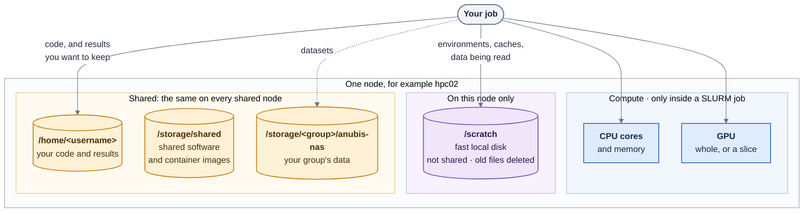

# Inside a node

[← Overview](README.md) · [Home](../README.md)

Every node is a Linux machine with CPU cores, memory, one GPU and a few disks. What matters to you is **where your files live**, because some places are shared between nodes and fast ones are not.

## Where do I put things?

| What | Where | Why |
|---|---|---|
| Source code, scripts, notes, final results | `/home/<username>` | The same on every shared node, so a job sees what you saved from `hpc01`. 200 GiB soft limit |
| Python environments, `pip` and model caches | `/scratch/<username>` | Much faster for many small files, and keeps your home small. Build them in a job, on the node that will use them |
| Data a job reads over and over | Copy it to `/scratch` at the start of the job | Reading from a local disk is faster, and does not slow other users down |
| Data your whole group shares | `/storage/<group>/anubis-nas` | Only your group can open it. Slower, so copy what a job reads heavily to `/scratch` |
| Shared software and container images | `/storage/shared` | Ask the admins if you need something added there |

Two rules of thumb:

- **`/scratch` is temporary.** It belongs to one node (a file written on `hpc02` is not visible on `hpc03`), and files not touched for 30 days are deleted.
- **Nothing here is backed up.** Keep a second copy of anything you cannot recreate, outside the cluster.

Quotas, `/scratch` clean-up rules and examples are in [Storage](../user-guide/03-storage.md).

## Firewall and network access

A firewall protects the nodes from the wider internet: SSH is reachable from anywhere, but other connections are blocked. Computers on the ISR network, or connected through [IST's VPN](https://si.tecnico.ulisboa.pt/en/servicos/redes-e-conetividade/vpn/), are additionally allowed to reach the nodes on ports 10000-50000, for example to open a web service that runs in your job.

## Shared nodes and group nodes

- **Shared nodes** (`hpc01`, `hpc02`, `hpc03`) all look the same to you: same `/home`, same `/storage`, same software.
- **Group nodes** (`hpc-<group>`) are run by each research group's admin. Before a group's node joins the cluster it has its own separate `/home`, and its own rules: follow your admin's instructions. After it joins, it behaves like a shared node as above, plus your group's jobs run there first. See [Group nodes](../user-guide/06-group-nodes.md).

You cannot install system packages on any node. For a full software stack, including CUDA libraries, use a [container](../user-guide/09-apptainer.md).

Next: [Who's who](contacts.md)
