# Inside a node

[← Overview](README.md) · [Home](../README.md)

All eight VMs have the same hardware, but the **shared nodes** (`hpc01`–`hpc03`) and the **group nodes** are laid out differently.

## Shared node (`hpc01`–`hpc03`)



Source: [diagrams/node-shared.mmd](diagrams/node-shared.mmd)

| Device | Backing | Size | Filesystem / use | Mount point | Survives VM rebuild? |
|---|---|---|---|---|---|
| `vda1` | VPS root volume | 80 GB | ext4, OS | `/` | Yes (volume) |
| `vdb` + `vdc` | CEPH | 2 × 780 GB | LVM `scratch_vg/scratch` (1.52 TB), ext4 | `/scratch` (mode `1777`) | Yes (CEPH) |
| `nvme0n1` | Local NVMe | 3.5 TB | xfs, label `mfschunk1` | `/mnt/mfschunks/chunk1` | **No** (ephemeral) |
| `nvme1n1` | Local NVMe | 3.5 TB | xfs, label `mfschunk2` | `/mnt/mfschunks/chunk2` | **No** (ephemeral) |
| MooseFS | NVMe on hpc01-03 | ~10.5 TiB usable at 2 copies | FUSE | `/mnt/mfs` | Survives loss of 1 node |

**Why bind mounts?** `/` is only 80 GB. `/home` and `/opt` come from MooseFS on all three shared nodes, so they're identical everywhere. On `hpc01` only, `/srv` and `/var/lib/docker` also come from MooseFS (`/mnt/mfs/hpc01/…`) to hold the Docker services.

**Note the inversion:** the "ephemeral" NVMe disks hold the *replicated* MooseFS data (protected by having 2 copies on different nodes), while the "persistent" CEPH volumes hold the *node-local* `/scratch`.

### `/etc/fstab` (hpc01)

```fstab
LABEL=cloudimg-rootfs / ext4 defaults 0 1
LABEL=mfschunk1  /mnt/mfschunks/chunk1  xfs  defaults,noatime,nofail  0 2
LABEL=mfschunk2  /mnt/mfschunks/chunk2  xfs  defaults,noatime,nofail  0 2
mfsmount  /mnt/mfs  fuse  mfsmaster=hpc01.isr-hpc.tp.vps.tecnico.ulisboa.pt,_netdev  0 0
/mnt/mfs/home     /home      none    bind    0  0
/mnt/mfs/opt     /opt      none    bind    0  0
/mnt/mfs/hpc01/srv     /srv      none    bind    0  0
/mnt/mfs/hpc01/var/lib/docker     /var/lib/docker      none    bind    0  0
UUID=2852ff56-b119-4844-885c-df8ca3300ea3 /scratch ext4 defaults,nofail 0 2
```

`hpc02` and `hpc03` have the same file without the `/srv` and `/var/lib/docker` lines, and with their own `/scratch` UUID.

## Group node



Source: [diagrams/node-group.mmd](diagrams/node-group.mmd)

Group nodes (`hpc-<group>`) have the same disks as the shared nodes, but are managed by each group's admin and are **not** part of MooseFS or SLURM. What they have in common:

- An 80 GB root disk for the OS, two CEPH volumes (persistent) and two local NVMe disks (ephemeral). How the CEPH and NVMe disks are used (LVM, `/home`, `/scratch`, extra mounts) is up to each group.
- Their own `/home`, **not the same `/home` as on the shared cluster.**
- Logins through SSSD against Authentik's LDAP outpost on `hpc01`, restricted to the group's own users.
- firewalld and fail2ban, the NVIDIA driver, and the local `ubuntu` admin account.

Node-specific layouts are in each group's guide, e.g. the hpc-dsor guide (not yet published). Admin baseline: [Group nodes (admin)](../admin-guide/config/group-nodes.md).

> **TODO:** Layout of the other four group nodes (in their own guides).

## Services

| Service | hpc01 | hpc02 / hpc03 | Group nodes |
|---|---|---|---|
| `sshd` + fail2ban + firewalld | ✓ | ✓ | ✓ |
| `sssd` (LDAP logins) | ✓ | ✓ | ✓ |
| NVIDIA driver | 595.71.05 (CUDA 13.2) | 595.71.05 | chosen by the group |
| `munge`, `slurmd` | ✓ | ✓ | — |
| `slurmctld` | ✓ | — | — |
| `moosefs-master`, `moosefs-cgiserv` | ✓ | — | — |
| `moosefs-metalogger` | — | ✓ | — |
| `moosefs-chunkserver`, MooseFS client | ✓ | ✓ | — |
| Docker | Traefik, Authentik, LDAP outpost (JupyterHub as admin reference only) | — | if the group uses it |
| Other services | — | — | chosen by each group |

Configuration details: [Base node](../admin-guide/config/base-node.md) · [MooseFS](../admin-guide/config/storage-moosefs.md) · [Group nodes](../admin-guide/config/group-nodes.md)
